&nbsp;&nbsp;&nbsp;&nbsp;&nbsp;&nbsp;&nbsp;&nbsp;

---

## 🏆 Highlights

<table>
<tr>
<td width="50%" valign="top">

### 🥈 2nd Prize — SEBI TechSprint 2026
**Global Fintech Fest (GFF)**

Built **IPO Sherpa**, an AI-powered platform for SME IPO document analysis, compliance checks, and prospectus drafting.

[`View IPO Sherpa →`](https://github.com/cjagadheesh/Automated-IPO-Drafter)

</td>
<td width="50%" valign="top">

### 🎓 Academic
- **97.79 percentile** in JEE Main 2024 (AIR 9677)
- B.E. Computer Science and Engineering, **Chennai Institute of Technology** (2024–2028)

</td>
</tr>
</table>

---

## 🧑‍💻 About Me

- 🎓 Computer Science undergraduate at **Chennai Institute of Technology** (2024–2028)
- 🧠 I build applied AI systems across **computer vision, LLM/RAG pipelines, OCR automation, and forecasting**
- 💼 Machine Learning Intern at **Hyundai Motor India** — developed a computer-vision PPE detection system and a production-planning analytics dashboard
- 🤖 Generative AI Intern at **Evolve Robot Lab** — built and deployed multi-turn chatbots with RAG and REST API integrations
- ☁️ Interested in taking ML applications from data and models through APIs, containers, and cloud deployment
- 🌱 Building my skills in **Linux, Docker, Kubernetes, AWS, and networking**

---

## 🛠️ Tech Stack

<table>
  <tr>
    <td align="center" width="96">
      
       Docker
    </td>
    <td align="center" width="96">
      
       Linux
    </td>
    <td align="center" width="96">
      
       Git
    </td>
    <td align="center" width="96">
      
       Nginx
    </td>
    <td align="center" width="96">
      
       Python
    </td>
    <td align="center" width="96">
      
       FastAPI
    </td>
  </tr>
  <tr>
    <td align="center" width="96">
      
       Node.js
    </td>
    <td align="center" width="96">
      
       JavaScript
    </td>
    <td align="center" width="96">
      
       C++
    </td>
    <td align="center" width="96">
      
       MongoDB
    </td>
    <td align="center" width="96">
      
       MySQL
    </td>
    <td align="center" width="96">
      
       Django
    </td>
  </tr>
</table>

 

---

## 🚀 Featured Projects

<table>
<tr>
<td colspan="2" valign="top">

### 🥈 [IPO Sherpa — SME IPO Compliance & Drafting Platform](https://github.com/cjagadheesh/Automated-IPO-Drafter) &nbsp; `2nd Prize · SEBI TechSprint 2026`

Automates document analysis and compliance workflows for SME IPO preparation. Combines OCR, RAG over SEBI ICDR requirements, cross-document validation, and AI-assisted prospectus drafting, with Docker-based deployment and a 75-test offline suite.

`FastAPI` `React` `Docker` `OCR` `RAG` `LLMs` `Polygon`

</td>
</tr>
<tr>
<td colspan="2" valign="top">

### 🌊 [OceanPulse — Maritime Freight Forecasting & Procurement](https://github.com/cjagadheesh/Freight-Cost-Detection-using-garch-and-catboost)

A forecasting and procurement optimization application combining GARCH and CatBoost models with SHAP explanations, time-series forecasts, and a PuLP-based vessel and procurement planner. The repository clearly labels its bundled dataset as illustrative, so forecast results should be treated as prototype outputs.

`Python` `GARCH` `CatBoost` `SHAP` `PuLP` `FastAPI` `React`

</td>
</tr>
<tr>
<td colspan="2" valign="top">

### 🌐 [College Multilingual Chatbot](https://github.com/cjagadheesh/Multilingual-Chatbot)

A college information assistant that supports **English, Hindi, and Tamil**, with voice input/output and document-grounded Q&A. Uses ChromaDB for semantic retrieval and integrates Gemini and Azure language and speech services.

`Python` `Flask` `RAG` `ChromaDB` `Gemini` `Azure Speech`

</td>
</tr>
</table>

---

## 🧭 Leveling Up

| 🟢 In daily use | 🟡 Actively learning | 🔵 Next on the list |
|:--|:--|:--|
| Docker & Compose | AWS hands-on (beyond the cert) | Kubernetes |
| Linux & Bash | CI/CD with GitHub Actions | Terraform / IaC |
| Git workflows | Observability & monitoring | Cloud cost optimization |
| Nginx & reverse proxying | Container security | Serverless on AWS |

---

## 📊 GitHub Stats

  

 

  

---

## 💼 Experience

| Role | Organization | Focus |
|---|---|---|
| Machine Learning Intern | Hyundai Motor India | PPE detection with YOLOv8; safety analytics dashboard |
| Generative AI Intern | Evolve Robot Lab | Multi-turn chatbots, RAG, and REST API integrations |

---

## 🎓 Certifications

| Credential | Issuer |
|---|---|
| AWS Cloud Practitioner Essentials | Amazon Web Services |
| CCNA — Introduction to Networks | Cisco Networking Academy |
| ServiceNow Creator Studio Delivery Accreditation | ServiceNow |
| MongoDB Basics for Students | MongoDB |
| Technology Job Simulation | Deloitte |
