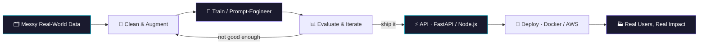

<!-- ═══════════════ HEADER ═══════════════ -->
<div align="center">
  
</div>

<div align="center">

<a href="https://www.linkedin.com/in/jagadheesh07/">
  
</a>

<br/>


<br/><br/>

<a href="https://www.linkedin.com/in/jagadheesh07/"></a>
<a href="mailto:jagadheeeeesh@gmail.com"></a>
<a href="https://github.com/cjagadheesh"></a>

</div>

<br/>

---

## 👾 `whoami`

```python
class Jagadheesh:
    role      = "AI/ML Engineer (in the making)"
    studying  = "B.E. Computer Science @ Chennai Institute of Technology (2024 – 2028)"
    interned  = ["Hyundai Motor India  →  ML / Computer Vision",
                 "Evolve Robot Lab     →  Generative AI"]
    superpower = "Turning messy real-world data into models that actually ship"
    stack     = ["Computer Vision", "GenAI & LLMs", "Full-Stack"]
    currently = "Building AI products: CV pipelines, GenAI chatbots, hiring engines"
    rank      = "JEE Main 2024 → 97.79 percentile (AIR 9677)"
    also      = "Smart India Hackathon participant"

    def mission(self):
        return "From factory floors to chat windows — build intelligent systems that matter."
```

---

## 🧰 Tech Arsenal

<div align="center">

**⚙️ Languages & Backend**<br/>


**🧠 AI / ML & Automation**<br/>


**🗄️ Data & Infra**<br/>


</div>

---

## 📈 Impact Dashboard

> *Numbers from things I've actually built and shipped.*

<div align="center">

<table>
<tr>
<td align="center" width="25%">
<h2>72% → 89%</h2>
<b>mAP lift</b><br/>
<sub>YOLOv8 PPE detection via dataset cleaning & augmentation</sub>
</td>
<td align="center" width="25%">
<h2>5,000+</h2>
<b>profiles trained on</b><br/>
<sub>Neural candidate-scoring model in Credence</sub>
</td>
<td align="center" width="25%">
<h2>~40%</h2>
<b>fewer irrelevant replies</b><br/>
<sub>Context-aware multi-turn chatbot workflows</sub>
</td>
<td align="center" width="25%">
<h2>3</h2>
<b>chatbots deployed</b><br/>
<sub>Built on OpenAI & Groq APIs</sub>
</td>
</tr>
</table>

</div>

---

## 🧬 How I Build

Every project I ship follows the same loop — **data first, model second, product always.**



---

## 🛰️ Mission Log

<details open>
<summary><b>🏭 PPE Detection System — Hyundai Motor India</b> &nbsp;·&nbsp; <code>Computer Vision</code></summary>
<br/>

Factory-floor safety shouldn't depend on someone watching a camera feed.

- 🎯 **Mission:** automatically detect workplace safety-gear compliance
- 🔧 **Approach:** fine-tuned **YOLOv8**; the real gains came from dataset cleaning and augmentation, not just model tweaking
- 📈 **Result:** mAP **72% → 89%**
- 🧰 `YOLOv8` `OpenCV` `Python`

</details>

<details>
<summary><b>🎯 Credence — AI Hiring Engine</b> &nbsp;·&nbsp; <code>Full-Stack + ML</code></summary>
<br/>

Resumes lie. Code doesn't.

- 🎯 **Mission:** evaluate candidates on what they actually build
- 🔧 **Approach:** integrates **GitHub & LeetCode APIs** to generate skill graphs, then scores candidates with a **neural network trained on 5,000+ profiles**
- 🧰 `Python` `Node.js` `Neural Networks` `REST APIs`

</details>

<details>
<summary><b>📄 AI Insurance Claims Automation</b> &nbsp;·&nbsp; <code>Document AI + Workflow</code></summary>
<br/>

- 🎯 **Mission:** take claims processing from manual paperwork to an automated pipeline
- 🔧 **Approach:** end-to-end platform combining intelligent document analysis with workflow automation
- 🧰 `Python` `n8n` `Document AI`

</details>

<details>
<summary><b>🤖 GenAI Chatbot Suite — Evolve Robot Lab</b> &nbsp;·&nbsp; <code>LLMs + Prompt Engineering</code></summary>
<br/>

- 🎯 **Mission:** chatbots that remember the conversation and stay on topic
- 🔧 **Approach:** 3 deployed bots on **OpenAI / Groq** with context-aware, multi-turn workflows
- 📈 **Result:** ~**40% fewer irrelevant responses**
- 🧰 `OpenAI` `Groq` `Prompt Engineering` `Python`

</details>

---

## 🔭 Radar

| 🟢 Shipping | 🟡 Learning | 🔵 Exploring |
|:--|:--|:--|
| YOLOv8 pipelines | RAG architectures | Agentic workflows |
| GenAI chatbots | LLM evaluation | Edge deployment for CV |
| FastAPI / Node services | MLOps with Docker & AWS | Multimodal models |

---

## 📊 GitHub Stats

<div align="center">


<br/>


<br/>


</div>

---

## 🏅 Certifications

<div align="center">


</div>

---

## 🤝 Let's Build Something

<div align="center">

Got a computer vision problem, a GenAI idea, or a hackathon team that needs one more builder?

<a href="mailto:jagadheeeeesh@gmail.com"></a>
<a href="https://www.linkedin.com/in/jagadheesh07/"></a>

<br/><br/>

<i>⭐ From safety-critical CV systems to shipping GenAI chatbots — always exploring the next intelligent system to build.</i>

</div>

<div align="center">
  
</div>
