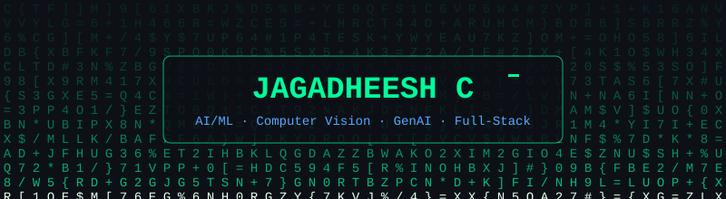

&nbsp;&nbsp;&nbsp;&nbsp;&nbsp;&nbsp;&nbsp;&nbsp;

---

## 🧑‍💻 About Me

- 🎓 Computer Science undergrad at **Chennai Institute of Technology** (2024 – 2028)
- ⚡ **Messy data enthusiast** — I like turning noisy real-world data into models that actually ship. Computer vision, LLMs, full-stack... if it can be made intelligent, I'm probably prototyping it.
- 💼 Machine Learning Intern @ **Hyundai Motor India** — built a YOLOv8 PPE detection system for factory safety
- 🤖 Generative AI Intern @ **Evolve Robot Lab** — shipped multi-turn AI chatbots with prompt engineering
- 🏆 **97.79 percentile** in JEE Main 2024 (AIR 9677) · Smart India Hackathon participant

---

## 🛠️ Tech Stack

<table>
  <tr>
    <td align="center" width="96">
      
       Python
    </td>
    <td align="center" width="96">
      
       C++
    </td>
    <td align="center" width="96">
      
       JavaScript
    </td>
    <td align="center" width="96">
      
       Node.js
    </td>
    <td align="center" width="96">
      
       FastAPI
    </td>
    <td align="center" width="96">
      
       Django
    </td>
  </tr>
  <tr>
    <td align="center" width="96">
      
       OpenCV
    </td>
    <td align="center" width="96">
      
       MongoDB
    </td>
    <td align="center" width="96">
      
       MySQL
    </td>
    <td align="center" width="96">
      
       Docker
    </td>
    <td align="center" width="96">
      
       Git
    </td>
    <td align="center" width="96">
      
       Linux
    </td>
  </tr>
</table>

 

---

## 🔨 Currently Building

<table>
<tr>
<td valign="top">

### 🎯 Credence &nbsp; `in progress`
**AI Hiring Engine**

A full-stack hiring platform that evaluates candidates on what they actually build. Integrates **GitHub and LeetCode APIs** to generate skill graphs, then ranks candidates with a **neural-network scoring model trained on 5,000+ profiles**.

`Python` `Node.js` `Neural Networks` `REST APIs`

</td>
</tr>
</table>

---

## 🚀 Featured Projects

<table>
<tr>
<td width="50%" valign="top">

### 🛡️ PPE Detection System
**Factory Safety-Gear Compliance Detection**

Computer vision system built at Hyundai Motor India to detect workplace safety-gear compliance. Fine-tuned **YOLOv8** and lifted mAP from **72% → 89%** through dataset cleaning and augmentation.

`YOLOv8` `OpenCV` `Python` `Computer Vision`

</td>
<td width="50%" valign="top">

### 📄 AI Insurance Claims Automation
**Intelligent Document & Workflow Platform**

End-to-end platform that automates insurance claims processing using intelligent document analysis and workflow automation, replacing manual paperwork with a streamlined pipeline.

`Python` `n8n` `Document AI` `Automation`

</td>
</tr>
<tr>
<td colspan="2" valign="top">

### 🤖 GenAI Chatbot Suite
**Context-Aware Multi-Turn AI Assistants**

Three deployed chatbots on **OpenAI and Groq APIs** with context-aware, multi-turn workflows built through careful prompt engineering. Cut irrelevant responses by **~40%**.

`OpenAI` `Groq` `Prompt Engineering` `Python`

</td>
</tr>
</table>

---

## 📊 GitHub Stats

  

 

  

---

## 💼 Experience

| Role | Organization | Focus |
|---|---|---|
| Machine Learning Intern | Hyundai Motor India | YOLOv8 PPE detection for factory safety |
| Generative AI Intern | Evolve Robot Lab | Multi-turn AI chatbots & prompt engineering |

---

## 🎓 Certifications

| Credential | Issuer |
|---|---|
| CCNA — Introduction to Networks | Cisco Networking Academy |
| AWS Cloud Practitioner Essentials | Amazon Web Services |
| MongoDB Basics for Students | MongoDB |
| Technology Job Simulation | Deloitte |
| Creator Studio Delivery Accreditation | ServiceNow |
